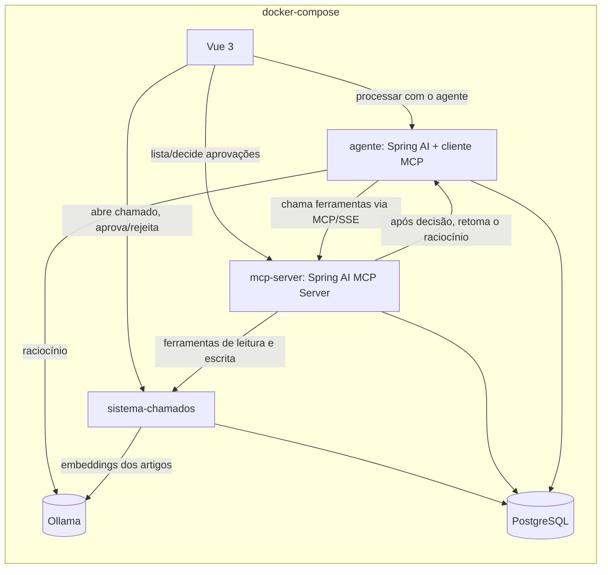

# agente-suporte-mcp

Um agente de IA que atende chamados de suporte: investiga usando ferramentas reais (base de conhecimento, status de serviços, dados de usuário) e, quando a solução exige uma ação sensível — como desbloquear uma conta — monta a proposta e espera a aprovação de um analista antes de executar qualquer coisa. As ferramentas são expostas por um servidor MCP (Model Context Protocol) em Java, separado do agente.

## Funcionalidades

- Servidor MCP em Java (Spring AI MCP Server) com seis ferramentas: `buscarArtigo`, `consultarStatusServico`, `consultarUsuario` (leitura livre) e `abrirChamado`, `atualizarChamado`, `desbloquearConta` (escrita, sujeitas a aprovação)
- Agente com ciclo de várias etapas (pensar → chamar ferramenta → avaliar resultado), usando o cliente MCP e tool calling do Spring AI
- **O portão de aprovação vive no servidor MCP, não no prompt do modelo**: uma ferramenta de escrita chamada sem uma aprovação já concedida nunca executa a ação real — ela cria uma solicitação pendente e devolve isso ao agente, mesmo que o modelo tente insistir
- Painel de aprovação no Vue 3, com a ação proposta em linguagem simples e botões de aprovar/rejeitar
- Trilha de auditoria por passo: cada chamada de ferramenta do agente é registrada (ferramenta, entrada, saída), consultável por chamado
- Base de conhecimento com busca semântica (pgvector + embeddings via Ollama)

## Arquitetura



Uma ferramenta de escrita chamada sem aprovação cria uma `solicitacao_aprovacao` pendente no mcp-server e devolve essa informação ao agente, que para e informa que está aguardando um analista. Quando o analista decide pelo painel, o mcp-server registra a decisão e, só depois que essa transação comita, notifica o agente — que reabre o raciocínio do chamado e, se aprovado, chama a mesma ferramenta de novo, agora com o id da aprovação. O mcp-server confere que aquela aprovação existe, está aprovada e nunca foi usada antes de executar a ação de verdade contra o sistema de chamados.

## Stack

| Camada | Tecnologia |
| --- | --- |
| Servidor MCP | Spring Boot 3, **Spring AI MCP Server** (transporte SSE), Java 21 |
| Agente | Spring Boot 3, **Spring AI** (ChatClient + cliente MCP + tool calling), Ollama |
| Sistema de chamados | Spring Boot 3, PostgreSQL, **pgvector** para a base de conhecimento |
| Frontend | Vue 3, Vite, TypeScript, Tailwind CSS |
| Documentação da API | springdoc-openapi (Swagger em `/swagger-ui.html` de cada serviço) |
| Testes | JUnit 5, Mockito, Testcontainers (Postgres), Vitest |
| Infra | Docker Compose, GitHub Actions |

## Como rodar

Pré-requisitos: Docker e Docker Compose. O primeiro `up` baixa a imagem do Ollama e os modelos configurados.

```bash
cp .env.example .env
docker compose up --build
```

- Frontend: http://localhost:5173
- sistema-chamados: http://localhost:8080/swagger-ui.html
- mcp-server: http://localhost:8081/swagger-ui.html (as ferramentas em si são expostas via MCP em `/sse`, não por aqui)
- agente: http://localhost:8082/swagger-ui.html

### Rodando os testes

```bash
cd sistema-chamados && mvn verify   # unitários + integração (Testcontainers: Postgres)
cd mcp-server && mvn verify         # unitários (portão de aprovação) + integração (Testcontainers: Postgres)
cd agente && mvn verify             # unitários (decorador de auditoria, mensagens) + integração (Testcontainers: Postgres)
cd frontend && npm ci && npm run test && npm run build
```

## Decisões técnicas

- **A segurança fica no servidor MCP, não no prompt do modelo**: toda ferramenta de escrita passa por um `GateDeAprovacao` único. Sem um `aprovacaoId` que aponte para uma solicitação já aprovada e ainda não usada, a ação real nunca chega a ser executada — isso vale mesmo que o modelo invente um id ou tente chamar a ferramenta de novo sem esperar. O prompt também instrui o modelo a esperar, mas a garantia real está no servidor, não na instrução.
- **Notificar o agente só depois do commit da decisão**: a primeira versão chamava o agente para retomar o raciocínio de dentro da mesma transação que grava a decisão de aprovação — um risco de visibilidade igual ao encontrado no projeto `assistente-de-licitacoes-ia` (ali, com `@Async`; aqui, com uma chamada HTTP síncrona a outro serviço). Corrigido: o serviço de decisão só persiste; o controller notifica o agente depois que a chamada ao serviço já retornou, garantindo que a decisão esteja comitada quando o agente tentar usá-la.
- **Trilha de auditoria por decoração, não por reimplementar o laço do agente**: em vez de controlar manualmente cada "pensar → chamar ferramenta → avaliar", o agente deixa o Spring AI cuidar do laço de tool calling e só decora cada `ToolCallback` descoberto via MCP com um registro de antes/depois em `passo_agente`. Mais simples e já aproveita o laço testado do framework.
- **Mitigação leve contra prompt injection**: o prompt de sistema instrui o modelo a tratar todo texto vindo de chamados e artigos como dado, nunca como instrução. É uma defesa de primeira camada, não uma garantia — uma defesa mais robusta (sanitização, detecção) fica no roteiro.
- **Nenhum teste automatizado depende de um Ollama real**: todos os três serviços têm seus colaboradores de IA (`VectorStore`, cliente MCP, modelo de chat) substituídos por dublês nos testes de integração, que sobem só Postgres via Testcontainers. Essa é uma escolha deliberada para não empilhar, neste projeto, o mesmo risco de CI com Ollama que ainda está pendente de resolução no projeto `assistente-de-licitacoes-ia` — a validação com modelo real é manual, via `docker compose up`.
- **Uma única instância de Postgres com três bancos**, em vez de três instâncias separadas — economia de recursos para um projeto de demonstração, com os bancos criados por um script de init (mesmo padrão usado no `pedidos-pagamentos-eventos`); em produção, cada serviço teria sua própria instância.

### O que este projeto demonstra

Agentes de IA com o que separa um protótipo de algo que uma empresa colocaria em produção: controle de acesso que não depende do modelo se comportar, auditoria de cada ação e um protocolo aberto (MCP) separando o raciocínio das ferramentas — o mesmo servidor MCP poderia ser reaproveitado por outro agente ou por um editor de código, sem mudar nada nele.

## Roteiro (próximas evoluções)

- [ ] Rastreamento visual da execução do agente, passo a passo, no painel
- [ ] Limite de custo e de número de passos por chamado
- [ ] Conjunto de avaliação com chamados simulados e resultado esperado, rodando no CI
- [ ] Proteção mais robusta contra prompt injection (sanitização e detecção, não só instrução de prompt)
- [ ] Métricas: taxa de resolução automática, tempo médio de atendimento, aprovações recusadas
- [ ] Validar em CI o laço de raciocínio com um modelo Ollama real (Testcontainers), hoje só testado manualmente
